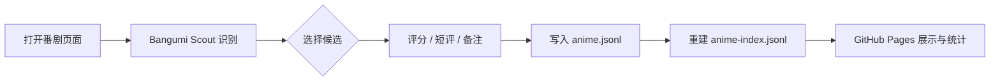

# MyAnimeLife

一个可以通过 GitHub Template 生成个人副本的番剧档案仓库，同时包含展示站、本地管理页和 Bangumi Scout 油猴脚本。完整记录集中保存在 `data/anime.jsonl`，轻量索引保存在 `data/anime-index.jsonl`，Bangumi 评分与标签的个人缓存保存在 `data/bangumi-cache.jsonl`；模板另外预置 `admin/bangumi-public-catalog.json` 与 `admin/bangumi-public.json`，让新用户无需首次下载即可搜索索引并读取公共 Bangumi 元数据。GitHub Actions 在部署时校验数据、套用模板并生成 GitHub Pages 静态网站。

## 先装油猴脚本

油猴脚本是 MyAnimeLife 的首要入口：打开 Bilibili 番剧页面即可识别当前作品，在 B 站个人追番页可以翻页批量导入，随后把评分、短评和封面写入你的个人数据仓库。

**[点击安装 Bangumi Scout 油猴脚本](https://raw.githubusercontent.com/zjsycwmrbig/MyAnimeLife/main/userscript/dist/anime-index.user.js)**

1. 先用 GitHub 的 [`Use this template`](https://github.com/zjsycwmrbig/MyAnimeLife) 创建自己的数据仓库，确保 `data/anime.jsonl` 和 `data/anime-index.jsonl` 保持为空。
2. 安装上面的脚本，在脚本设置中填写个人仓库地址、分支和 GitHub Fine-grained Token；只需要目标仓库的 `Contents: Read and write` 权限。
3. 打开普通番剧页识别并保存，或打开 B 站个人追番列表，翻页后批量选择并一次同步。

Token 只缓存在当前浏览器站点，不会写入仓库或分享链接。完整的安装检查、权限说明、识别模式和 B 站批量导入说明见 [`userscript/README.md`](userscript/README.md)。

## 先看效果

MyAnimeLife 把“发现番剧、记录感受、回顾数据”放在同一条流程里。下面的截图来自仓库内的可复现页面和 UI 测试素材：

<table>
  <tr>
    <td width="50%"></td>
    <td width="50%"></td>
  </tr>
  <tr>
    <td align="center"><b>展示首页</b><br />封面墙、评分、短评摘要、搜索和筛选</td>
    <td align="center"><b>详情页</b><br />评分、评价、备注、季度和外部索引</td>
  </tr>
</table>

<table>
  <tr>
    <td width="50%"></td>
    <td width="50%"></td>
  </tr>
  <tr>
    <td align="center"><b>在线管理页</b><br />索引卡片流、分页、批量评分和评价</td>
    <td align="center"><b>油猴识别面板</b><br />页面识别、候选匹配和一键保存</td>
  </tr>
</table>

<p align="center"></p>
<p align="center"><b>设置与接入引导</b><br />配置个人数据仓库、分支、Token 和 Pages，脚本会逐步检查接入状态。</p>



> 图片只是展示用的 UI 素材，不包含模板仓库的个人记录。真正使用时，展示页会读取你自己的 `data/anime.jsonl`。

仓库中的数据和模板彼此独立：

```text
data/anime.jsonl + data/anime-index.jsonl + templates/<current>/ = dist/*
data/anime.jsonl + data/anime-index.jsonl <-> userscript/ = Bangumi Scout
```

因此替换模板不需要迁移个人记录，修改个人记录也不会触碰页面代码。

## 页面能力

- 首页展示全部番剧、封面、评分、作品年份、季度、评价摘要和匹配状态；公开页面中的日期指作品年代，不使用记录更新时间代替
- 封面优先使用记录中的地址；旧的 `http` 地址会在构建时升级为 `https`，缺少封面的 Bangumi 记录会在展示页按需恢复并缓存
- 支持标题、评价、备注和跨站索引 ID 搜索
- 我的记录支持关键词、内容状态、评分范围、作品年份和收录日期组合筛选，并可切换收录时间、修改时间、评分、作品年份和标题的正倒序
- 每部番剧有独立详情页，底部会根据 Bangumi 公共标签和个人标签缓存计算相似推荐；默认隐藏已收录作品，可切换查看全部，并按共同标签数量排序、分页展示
- 显示 Bangumi、Bilibili、AniList、MyAnimeList 的关联 ID 和链接
- 构建时自动生成供油猴脚本读取的 `dist/data/library.json`
- 同时提供本地批量管理页和 GitHub Pages 在线管理页，可搜索、编辑评分和评价、批量删除并提交到远端
- 管理页可多选 `bangumi-data` 全量索引，逐条填写评分和评价后一次加入档案或加入并同步
- 管理页的我的记录和全量索引支持列表/封面卡片视图；分页默认每页 30 条，也支持 10 条或自定义 1 到 200 条
- 管理页可集中检查站点 ID、同季度同名和相似标题重复项，并定位编辑或批量删除
- 提供 `/insights/` 数据洞察页，使用标签切换收录趋势、年份扇状图、评分分布和索引覆盖，模块内部支持轮播
- 提供独立的 `/compare/` 仓库 PK 页，可比较总量、重合量、评分覆盖率、年份分布、评分区间和共同作品评分差
- 内置三套展示模板、三套分享图版式和四套分享配色，可在管理页“站点样式”中切换
- 单番剧分享会先打开大卡片预览，可复制图片、下载 PNG 或下载 SVG
- 洞察页分享可勾选摘要、趋势、年代、评分、索引和 PK 模块，并切换长图或社交卡片版式
- 展示页导航提供直接进入在线管理页的入口

完整截图素材位于 [`docs/screenshots/`](docs/screenshots/)，可用于了解展示页、详情页、管理页和油猴脚本的实际界面。

GitHub Pages 会发布只读展示网站和在线管理页。在线管理页默认允许公开只读浏览；填写 GitHub Token 并验证后，Token 会缓存到当前浏览器当前站点，之后可自动填充并直接编辑记录、创建远端提交，不需要在本地启动服务器。

## 油猴脚本

`userscript/` 包含 Bangumi Scout 的完整源码、测试和可直接安装的构建产物。上游版本可以从以下地址安装：

```text
https://raw.githubusercontent.com/zjsycwmrbig/MyAnimeLife/main/userscript/dist/anime-index.user.js
```

在 Tampermonkey 中打开该地址，或新建脚本后粘贴内容即可。脚本通过 GitHub Contents API 读写个人仓库中的 `data/anime.jsonl` 和 `data/anime-index.jsonl`，不要求个人仓库与模板同名。详细设置和识别机制见 [`userscript/README.md`](userscript/README.md)。

如果希望脚本更新也完全由自己的仓库管理，可以把上述地址中的 `zjsycwmrbig/MyAnimeLife` 替换成自己的 `owner/repository`。使用 Template 创建的个人数据仓库同样会包含 `userscript/dist/anime-index.user.js`。

## 创建个人仓库

推荐使用 GitHub 的 `Use this template`，不要直接 Fork。模板生成的仓库与上游提交历史无关联，只包含默认分支当前文件，因此不会继承上游历史中的番剧记录。

1. 仓库所有者在[上游设置](https://github.com/zjsycwmrbig/MyAnimeLife/settings)中启用 `Template repository`。
2. 运行 `npm run template:check`，确认公开状态、Template 开关、默认分支和空数据都正确。
3. 打开仓库页面，点击 `Use this template > Create a new repository`。
4. 修改新仓库 [`config/site.json`](config/site.json) 中的站点名称和描述。
5. 新仓库的 `data/anime.jsonl` 与 `data/anime-index.jsonl` 为空。通过油猴脚本保存第一条记录，或按 [`data/README.md`](data/README.md) 手动新增。
6. 进入新仓库 `Settings > Pages`，把 Source 设置为 `GitHub Actions`。
7. 推送到 `main` 分支，等待 `Deploy GitHub Pages` 工作流完成。

构建器会自动从 GitHub Actions 环境读取仓库地址，因此详情页能够生成正确的“在 GitHub 编辑数据”链接，不需要在配置中写死用户名。

公开模板仓库必须同时满足以下条件：

- `Visibility` 为 `Public`。
- `Settings > General > Template repository` 已勾选。
- 默认分支为 `main`。
- `data/anime.jsonl`、`data/anime-index.jsonl` 为 0 字节。
- `data/backups` 中没有 JSON 备份文件。

如果以后给上游增加了其他分支，新用户从模板创建仓库时应保持 `Include all branches` 未勾选。油猴设置中的“检查模板”也会在创建前验证前三项；`npm run template:check` 还会检查数据文件和备份。

## 模板、Fork 与分支隔离

GitHub 不支持只 Fork 某一个分支。Fork 会复制仓库当时可见的全部分支和提交历史；GitHub 也没有“只对 Fork 隐藏 JSONL 记录”的能力。`.gitignore` 不能让已经提交的记录从 Fork 中消失，`.gitattributes export-ignore` 也只会影响源码归档。

因此本项目把 `Use this template` 作为推荐路径：

- `zjsycwmrbig/MyAnimeLife` 的 `main` 分支始终保持两个 JSONL 文件为空。
- 新用户通过 `Use this template` 生成一个提交历史无关联的个人仓库。生成结果只包含模板默认分支的当前文件，不继承其他分支，也不继承上游旧提交中的记录。
- 第一条评分或评价只会写进用户自己的个人仓库。
- 上游部署前会运行空白检查；如果模板仓库误提交了个人记录，发布流程会直接失败。
- 个人记录不要提交到上游模板，也不需要向上游发 Pull Request。
- 如果要让同一套模板生成自己的站点，请在自己的个人仓库中录入和维护记录。

当前上游历史曾包含示例记录。最新提交删除这些文件并不会把它们从 Git 历史中移除，所以直接 Fork 仍可能从旧提交恢复它们。若历史中的记录也不应继续公开，需要重建或重写上游仓库历史；已有 Fork 不会因为上游随后删除文件而自动清除旧数据。

如果希望把模板和个人数据放在不同分支，可以采用 `main + records` 组织方式：

1. 先通过 `Use this template` 创建个人仓库，此时默认 `main` 继承空模板。
2. 从 `main` 新建 `records` 分支，只在 `records` 分支提交 `data/anime.jsonl` 与 `data/anime-index.jsonl`。
3. 在仓库 `Settings > General` 中把默认分支切换为 `records`。
4. 油猴脚本的 GitHub 分支设置填写 `records`。
5. 保持 `main` 为空，不把个人记录合并回去。

Pages 工作流只在当前默认分支执行，因此把 `records` 设为默认分支后，它才会发布个人站点。分支方案便于保持 `main` 干净，但**不是隐私边界**：公开仓库的所有分支都可被访问，也都会被 Fork 复制。需要真正私密的数据时，必须使用私有仓库，或把数据拆到独立的私有仓库。

本项目当前采用“公开模板仓库 + 个人数据仓库”的双仓库工作流：

- `zjsycwmrbig/MyAnimeLife` 是公开上游模板，负责代码、页面、管理工具、油猴脚本和工作流。
- `zjsycwmrbig/my-anime-life` 是维护者的个人数据仓库，包含上游代码与个人记录。
- 新用户通过 `Use this template` 创建自己的数据仓库，而不是直接 Fork 上游。
- 上游功能更新需要同步合并到个人数据仓库，但个人仓库中的 `data/anime.jsonl`、`data/anime-index.jsonl`、`data/backups/` 和个人配置必须原样保留。
- 不应对个人数据仓库使用整仓覆盖、强制重置或会删除数据目录的同步方式。

## 本地运行

```bash
npm install
npm run validate
npm test
npm run dev
```

开发油猴脚本需要单独安装其依赖：

```bash
npm install --prefix userscript
npm run test:userscript
npm run build:userscript
npm run test:e2e:userscript
```

本地预览默认运行在：

```text
http://127.0.0.1:4173
```

本地管理页使用另一个命令启动：

```bash
npm run admin
```

默认地址为 `http://127.0.0.1:4174/admin/`。服务只监听本机回环地址，使用本地 Git 提交和推送。

常用命令：

```bash
npm run validate  # 只校验配置、Schema、模板和索引
npm run build     # 生成 dist/
npm test          # 运行构建和 Schema 测试
npm run check     # 测试后重新构建
npm run check:all # 同时检查站点和油猴脚本
npm run admin     # 启动本地数据管理页
npm run build:userscript        # 构建油猴脚本
npm run test:userscript         # 运行油猴脚本单元测试
npm run test:e2e:userscript     # 运行油猴脚本浏览器测试
```

## 本地管理页

管理页面向已经克隆到本机的个人仓库，可以：

- 按标题、评价、备注、作品年份和站点 ID 搜索
- 按已评分、未评分、已有短评、已有备注以及评分、作品年份、收录日期范围组合筛选
- 按添加时间、修改时间、评分、作品年份和标题正倒序排列，默认显示最新添加的记录
- 多选并批量删除番剧
- 编辑标题、评分、评价和备注
- 在全量索引中按中文标题、原名、站点 ID、年份和来源查找作品
- 多选全量索引作品，逐条设置评分、评价、展示标题和备注，一次写入本地
- 可切换列表和封面卡片流式视图，批量选中详情按最近选中顺序显示并带有封面加载状态
- 已选数量会固定显示，可一次“加入本地”或“加入并同步”；批次内重复和已在档案中的站点 ID 会汇总跳过
- 重复检查会显示确定重复和疑似重复分组，支持按组选择、定位到记录编辑和批量删除
- 查看当前分支、origin 和未提交状态
- 一键提交 `data/anime.jsonl`、`data/anime-index.jsonl` 与备份，并推送到 origin

保存时页面会读取当前 JSONL，原子写入完整数据和重建后的索引，再从本地 Git 仓库提交。若本地已有其他未跟踪文件，它们不会进入这次数据提交。

每次内容实际发生变化时，覆盖前都会生成一个同时包含完整 JSONL 和索引 JSONL 的快照：

```text
data/backups/library-<timestamp>-<hash>.json
```

配置中的 `backupLimit` 默认为 `5`。超过上限时，按备份文件名从旧到新删除；JSONL 文件以当前写出的完整内容为准，不做追加。

## GitHub Pages 在线管理

构建后的管理页地址为：

```text
https://<owner>.github.io/<repository>/admin/
```

同一套管理界面会自动识别运行环境：

- 在 `localhost` 或 `127.0.0.1` 上由 `npm run admin` 启动时，使用本地 Node 服务、文件系统和 Git 命令。
- 在其他静态托管环境中，直接使用 GitHub API 读取和写入数据仓库，不依赖本地服务。

在线模式的行为：

- 公开数据仓库不填写 Token 也能浏览记录、全量索引、重复检查和统计信息。
- 公开浏览通过 HEAD SHA 从 `raw.githubusercontent.com` 读取配置、记录索引和个人 Bangumi 缓存，只使用两次 GitHub API 调用来确定当前提交和 Git 树。
- 编辑、批量加入和删除需要 GitHub 细粒度 Token；验证成功后 Token 会保存在当前浏览器当前站点的 `localStorage` 中，之后打开管理页会自动填充，不会写入 URL、日志或仓库文件。点击“清除 Token”会同时删除本地缓存；请只在自己的设备上使用，并仅授予目标数据仓库的 `Contents: Read and write` 权限。
- 编辑番剧数据时只需对目标数据仓库授予 `Repository permissions > Contents: Read and write`。如果还要在管理页执行“从模板更新”，模板中包含 `.github/workflows/`，Token 还必须额外授予 `Repository permissions > Workflows: Read and write`；不需要 Actions、Administration 或其他仓库权限。
- 每次在线修改都会先读取远端 HEAD，再用 Git Data API 创建 blobs、tree、commit，最后以非强制方式更新分支。番剧数据、轻量索引和新备份位于同一个提交中；Bangumi 个人缓存使用独立提交，不创建番剧备份。
- 如果编辑期间远端分支已有新的提交，更新分支会被拒绝，页面会提示先刷新再重试，不会覆盖其他人的改动。
- 每次实际修改前仍会生成包含完整 JSONL 和索引 JSONL 的备份，并按 `backupLimit` 在同一个提交中轮换旧备份。
- 在线模式的“同步远端”不会重复推送，因为保存已经完成远端提交；它会重新读取 GitHub 上的最新状态。

### 全量索引

管理页的“全量索引”视图使用 npm 包 [`bangumi-data`](https://github.com/bangumi-data/bangumi-data) 作为发现和选择作品的公共目录。它不会修改或替代个人记录，只有点击“添加到我的档案”后，才会在本机数据中创建记录。

- 第一次进入该视图时才下载索引，不会影响管理页启动速度。
- 下载优先使用 jsDelivr，失败时回退到 unpkg。
- 本地管理页将索引缓存在 `.cache/bangumi-data.catalog.json`，该目录已加入 `.gitignore`，不会提交到个人仓库。
- GitHub Pages 在线管理页在 Web Worker 中下载索引，并缓存到浏览器的 IndexedDB，不阻塞主界面。
- 缓存默认 24 小时内直接复用；超过 24 小时后再次进入或点击“检查索引更新”时，才检查 npm 版本。也可以随时手动检查。
- 搜索会优先展示中文标题，同时匹配日文原名、其他译名、Bangumi/Bilibili/AniList/MAL 站点 ID，并支持空格分词模糊匹配。
- 记录 ID 或任一外部站点 ID 已存在时会阻止添加，避免同一作品重复入库。

`bangumi-data` 的部分版本不提供可直接依赖的封面字段。管理页会先使用索引自带的 `coverUrl` 或图片字段；分页加载后，再只为当前页缺少封面的条目按 Bangumi ID 惰性请求封面并缓存到浏览器。封面服务不可用时仍会显示标题首字占位图，不会阻塞索引搜索和批量选择。

发现页还会以 Bangumi Archive 静态快照和 Bangumi API 作为评分与标签来源，为当前页已有 Bangumi ID 的番剧按需读取评分、评分人数、排名和标签。新结果先进入浏览器 IndexedDB，并明确标记为“本机待保存”；只有点击“保存本页”或“合并本机”后，才会合并写入个人仓库的 `data/bangumi-cache.jsonl`。展开“Bangumi 评分与标签”可以查看个人缓存条数、本机待同步条数、文件大小和最近更新时间，也可以按页保存、合并本机、移除本页个人缓存或清空缓存。

个人缓存按 `subjectId` 覆盖，同一 Bangumi 条目的较新 `fetchedAt` 胜出。它和番剧记录、评分、评价是不同数据，不会修改个人记录，也不会进入模板仓库；模板更新会完整保留 `data/`，因此个人缓存不会被管理页更新覆盖。请求失败不会覆盖已有缓存，没有可用 Bangumi 信息的条目也不会显示评分或标签。Bangumi 评分区间、标签、信息可用性和评分排序只针对当前页的个人或本机缓存。

### 从模板更新管理页

GitHub Pages 在线管理页的“关于我们”页面提供“检查模板更新”和“拉取最新管理页”。它会读取公开模板仓库 `zjsycwmrbig/MyAnimeLife` 的 `main` 分支，并在当前数据仓库创建一次新的 Git 提交。整个 `data/` 目录和 `config/site.json` 会沿用数据仓库中的版本，包括番剧记录、索引、备份和站点样式设置；其他文件会按模板当前版本重建，当前仓库自行修改的页面、工作流和脚本可能被覆盖。

更新需要对当前数据仓库拥有 `Contents: Read and write` 和 `Workflows: Read and write` 权限的细粒度 Token，因为同步范围包含 `.github/workflows/`。执行前页面会显示覆盖提醒并要求确认；如果更新期间分支产生了新提交，操作会被拒绝，不会强制覆盖远端改动。

### 数据洞察与仓库 PK

构建器会生成 `/insights/` 数据概览页和 `/compare/` 仓库 PK 页，使用已隐藏软删除记录后的个人数据计算：

- 近 7 天、近 30 天和近 365 天新增数量
- 最近 12 个月收录趋势
- 番剧年份扇状图、逐年分布、各年代平均评分和评分最高年代
- 评分区间、未评分比例、外部站点索引及季度信息覆盖率

页面顶部的“分享洞察图”会打开分享工作台。用户可以只选择需要的概览模块，并在长图和 1600 × 1000 卡片之间切换；图案完全在浏览器本地生成，支持复制 PNG、下载 PNG 和下载 SVG。仓库比较则在独立 PK 页面完成。

“仓库 PK”页面会读取当前站点的 `/data/library.json`，并根据 `owner/repository` 和分支，从以下公开地址读取对方轻量索引：

```text
https://raw.githubusercontent.com/<owner>/<repository>/refs/heads/<branch>/data/anime-index.jsonl
```

只支持可公开读取的仓库和分支；单个索引响应最多读取 8 MiB。作品先按记录 `id` 匹配，再按 Bangumi、Bilibili、AniList、MAL 等稳定外部 ID 匹配。不同季度应由不同记录 ID 和季度元数据表达，不会被主动合并为同一部作品。

配置了 `repository.slug` 后，可以使用“分享 PK 邀请”。它复制以下格式的链接：

```text
https://<pages-host>/insights/?peer=<owner>/<repository>&branch=<branch>
```

对方打开后会填入分享者仓库并自动开始 PK。GitHub Pages 上的 `repository.slug` 会从 Actions 环境自动取得；本地预览时需要在 `config/site.json` 中显式填写。静态页面无法在对方未登录或未授权的情况下自动识别其 GitHub 用户名，因此不会猜测访客自己的 Fork 地址；对方可以修改输入框后继续比较自己的仓库。

## 仓库结构

```text
.
├─ .github/workflows/pages.yml
├─ .github/workflows/userscript.yml
├─ admin/
│  ├─ index.html
│  ├─ styles.css
│  ├─ app.js
│  ├─ catalog.js
│  ├─ duplicates.js
│  ├─ runtime.js
│  ├─ github-client.js
│  ├─ browser-catalog-store.js
│  └─ catalog-worker.js
├─ config/site.json
├─ data/
│  ├─ anime.jsonl
│  ├─ anime-index.jsonl
│  └─ backups/
├─ schemas/
│  ├─ anime.schema.json
│  └─ anime-index.schema.json
├─ scripts/
│  ├─ admin-data.mjs
│  ├─ admin.mjs
│  ├─ admin-store.mjs
│  ├─ build.mjs
│  ├─ catalog-data.mjs
│  ├─ catalog-store.mjs
│  ├─ duplicate-data.mjs
│  ├─ insights-data.mjs
│  ├─ library-data.mjs
│  ├─ validate.mjs
│  └─ serve.mjs
├─ templates/
│  ├─ default/
│  ├─ compact/
│  └─ spotlight/
├─ userscript/
│  ├─ src/
│  ├─ tests/
│  ├─ e2e/
│  └─ dist/anime-index.user.js
└─ tests/
```

`dist/` 是构建产物，不提交到 Git。GitHub Actions 会把整个目录上传为 Pages artifact。

## 数据标准

`data/anime.jsonl` 是唯一数据源。每行保存一条完整的 JSON 对象，文件末尾保留换行；空库就是一个 0 字节文件。

```text
data/anime.jsonl
```

`data/anime-index.jsonl` 是从完整数据确定性生成的轻量索引，用于重复检测和公开页面接口。不要手工维护它；运行管理页、构建或校验流程会比对两份数据是否一致。

`id` 创建后不要修改。推荐使用稳定来源：

```text
bili-292073015
bgm-420628
manual-01jabcdef
```

`data/anime.jsonl` 中一行的最小示例：

```json
{"schemaVersion":1,"id":"bili-292073015","title":"相反的你和我","rating":9.2,"review":"我的评价。","coverUrl":"https://example.com/cover.jpg","note":"我的备注。","externalIds":{"bangumi":"525565","bilibiliMedia":"292073015","bilibiliSeason":"129142","anilist":"184951","mal":"60371"},"season":{"key":"bgm:525565","number":1,"label":"第1季","year":2023},"match":{"status":"matched","method":"site-id","source":"bangumi-data","confidence":1,"matchedTitle":"正反対な君と僕","matchedAt":"2026-10-25T08:30:00Z"},"createdAt":"2026-10-25T08:30:00Z","updatedAt":"2026-10-25T08:30:00Z"}
```

字段规则：

| 字段 | 规则 |
|---|---|
| `id` | 在完整文件中不可重复，创建后不要修改 |
| `title` | 页面展示名称，可以来自匹配或手动输入 |
| `rating` | `null` 表示未评分，否则为 `0` 到 `10` 的数字 |
| `review` | 我的评价，支持 Markdown，原始 HTML 会被禁用 |
| `coverUrl` | 封面 URL；没有时为 `null` |
| `note` | 给人看的补充备注，支持 Markdown |
| `externalIds` | 跨站索引，全部使用字符串 |
| `season` | 可选季度身份；`number` 与 `label` 必须同时填写或同时为 `null` |
| `match` | 匹配状态、来源、方式、置信度和原始标题 |
| `createdAt` | 创建时间，ISO 8601 时间字符串 |
| `updatedAt` | 最后更新时间，ISO 8601 时间字符串 |
| `deletedAt` | 可选；非空时默认页面会隐藏该记录 |

完整约束见 [`schemas/anime.schema.json`](schemas/anime.schema.json)，详细编辑说明见 [`data/README.md`](data/README.md)。

构建器还会额外检查：

- 是否存在重复 `id`
- 同一个 Bilibili、Bangumi、AniList 或 MAL ID 是否被多条记录占用
- 季度编号与季度标签是否成对出现
- JSON 是否符合 Schema
- `anime-index.jsonl` 是否与 `anime.jsonl` 确定性重建的结果完全一致
- 模板声明和入口文件是否完整

## 公开数据接口

构建结果包含：

```text
/data/library.json
```

该文件是生成产物，不需要手动维护。结构如下：

```json
{
  "schemaVersion": 1,
  "generatedAt": "2026-10-25T12:00:00.000Z",
  "itemCount": 0,
  "items": []
}
```

油猴脚本应读取这个地址，而不是直接遍历 GitHub 仓库。更新 JSONL 数据后，GitHub Actions 会重新生成它。

## 更换模板

内置模板：

| 模板 | 布局特点 | 适合场景 |
|---|---|---|
| `default` | 封面卡片与编号档案风 | 通用展示，兼顾封面和评价摘要 |
| `compact` | 单列高密度清单，缩小封面和工具栏 | 记录很多、频繁搜索和快速扫描 |
| `spotlight` | 深色海报墙，放大封面和标题 | 以视觉浏览和作品回顾为主 |

在管理页“站点样式”中切换模板，或直接修改 `config/site.json`。这些设置不需要迁移 `data/anime.jsonl` 或 `data/anime-index.jsonl`：

```json
{
  "template": "compact",
  "share": {
    "template": "auto",
    "accent": "teal"
  }
}
```

分享模板支持 `auto`、`default`、`compact`、`spotlight`。`auto` 会跟随展示模板；分享配色支持 `coral`、`teal`、`blue`、`amber`。单番剧分享图统一读取封面、标题、10 分评分、短评和作品年代；洞察分享图使用同一套模板与配色，并支持按模块生成长图或卡片。

管理页也会读取同一份展示模板、分享配色、站点标题和品牌标识：切换选项时可即时预览，保存后管理页、阅读页和分享图使用同一套外观配置。首页评分和年份筛选使用离散双端档位，既可直接选择起止值，也可点击或拖动刻度条。

管理页顶部的“回到阅读页”入口固定在左侧，不再展示仓库、分支和写权限状态。进入“关于我们 / 更新管理页”时会自动比较模板仓库与当前数据仓库的非数据文件树；只有检测到差异时才显示醒目的更新提示和“拉取最新管理页”按钮，否则只保留“检查更新”。

模板目录必须包含自己的 `template.json`：

```json
{
  "id": "default",
  "name": "Archive",
  "contractVersion": 1,
  "entrypoints": {
    "index": "index.njk",
    "detail": "detail.njk",
    "insights": "insights.njk",
    "notFound": "404.njk"
  },
  "assets": "assets"
}
```

模板契约版本当前为 `1`。构建器向模板提供：

- `site`：站点配置
- `repository`：当前 GitHub 仓库信息
- `records`：首页记录集合
- `record`：详情页当前记录
- `similarEndpoint`：详情页当前记录的相似推荐分片地址
- `similarCatalogEndpoint`：全部相似推荐分片的概览地址
- `stats`：收录数、已评分数量和平均分
- `insights`：收录窗口、月度趋势、年代、评分和索引覆盖统计
- `homeUrl`：适合当前页面层级的首页地址
- `assetRoot`：适合当前页面层级的静态资源地址
- `currentDataUrl`：统计页读取当前档案公开数据的相对地址
- `generatedAt`：本次构建时间

默认模板还使用 `Nunjucks` 的 `markdown`、`formatDate`、`formatDateTime` 和 `json` 过滤器。其他模板可以完全重写 HTML、CSS 和浏览器脚本，但不能修改数据字段。

## 数据源说明

仓库初始为空，不附带演示番剧或第三方站点数据。油猴脚本完成识别后，会把稳定站点 ID、标题、评分和评价写入 `data/anime.jsonl`，并同步重建 `data/anime-index.jsonl`。

后续如果接入 Bilibili PGC 或 Bangumi API，应将这些访问封装在独立 adapter 中，并进行缓存、限流和失败回退。Bilibili 的 `media_id` 与 `season_id` 必须分别保存。

## License

仓库代码使用 MIT License。用户自行写入的番剧名称、封面和元数据归各自权利方所有。
